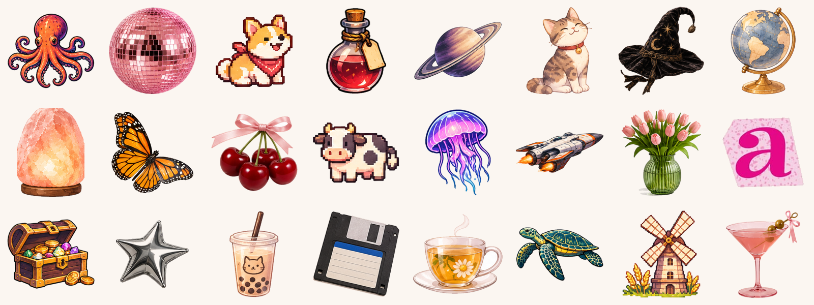

# Sticker Library

Free sticker sprites with transparent backgrounds, sorted into themes and tagged so you can search them. Use them in planners, slides, games, websites, social posts, or whatever you're making. No sign-up, no credit required.

**Browse and download:** https://sabrinabedjera.github.io/sticker-library/



## What's inside

375 stickers across 14 themes:

| Theme | Style | Stickers | Vibe |
|---|---|---:|---|
| Girly Pop | photo | 18 | Pink Y2K glam: disco balls, bows, cherries, lattes |
| Cozy Home | photo | 34 | Pink and sage home decor: lamps, pillows, vases, plants |
| Cottagecore | photo | 22 | Florals, teacups, gingham and wildflowers |
| Witchy | photo | 19 | Moody antiques: candles, crystals, roses, a witch hat |
| Streetwear | photo | 17 | Chrome stars, vinyl, skateboards, late-night vibes |
| Desktop | photo | 12 | 90s computer-desk nostalgia: floppies, tapes, boombox |
| Mission Control | illustrated | 22 | Retro space program: planets, rockets, badges |
| RPG | illustrated | 27 | Fantasy quest kit: potions, maps, shields, treasure |
| Deep Sea | illustrated | 32 | Ocean research: sea creatures, dive gear, specimen jars |
| Study Club | watercolor | 24 | Soft watercolor study desk: books, pens, coffee |
| Spa | watercolor | 18 | Calm self-care: candles, oils, stones and tea |
| Pixel | pixel art | 34 | Cozy pixel-art farm: animals, crops, cottage life |
| Cat Cafe | illustrated | 23 | Cats, coffee and pastries in a cozy cafe |
| Ransom Letters | collage | 73 | Pink cut-out magazine letters, a to z |

## How to use them

- **Easiest:** open the [gallery](https://sabrinabedjera.github.io/sticker-library/) and search (try `cat`, `rocket`, `potion` or `pink`). Click a sticker, then **Download PNG**.
- **Grab a file directly:** every sticker lives at `sprites/<theme>/<name>.png`, for example `sprites/deep-sea/octopus.png`.
- **Use it in code:** link the file, for example
  `https://sabrinabedjera.github.io/sticker-library/sprites/pixel/corgi.png`
- **Everything at once:** on GitHub, click **Code → Download ZIP**.

Stickers are sticker-sized: most are 150 to 700 px on their longest side. That's great for planners, slides and web pages, but too small for big prints. Small `.webp` previews live in `thumbs/` for galleries. Use the PNGs in `sprites/` for anything you'll show larger.

## The index (`sprites.json`)

Every sticker is listed in [`sprites.json`](sprites.json), so you can build your own picker or search:

```json
{
  "id": "deep-sea/octopus",
  "name": "octopus",
  "theme": "deep-sea",
  "style": "illustrated",
  "file": "sprites/deep-sea/octopus.png",
  "thumb": "thumbs/deep-sea/octopus.webp",
  "width": 250,
  "height": 216,
  "tags": ["animal", "deep", "deep-sea", "illustrated", "ocean", "octopus", "sea"]
}
```

The file also has a `themes` list with each theme's title, style, description and count.

## License

[CC0 1.0](LICENSE). The stickers are in the public domain. You can use them, change them, and sell things you make with them, without asking. Credit ("stickers by Sabrina Bedjera") is lovely but never required.

## Good to know

- **These are AI-generated.** I made the original sticker sheets with AI image tools (mostly ChatGPT), then cut each sticker out into its own transparent PNG. If a platform asks you to label AI art, please do.
- **No brand logos.** Stickers that showed real logos or branded screens (computer, sneaker and phone brands, a sports cap) were left out on purpose. The pink flip phone had its logo removed, and the old monitor's screen was repainted.
- **Cut-outs are mostly automatic.** A few photo-style stickers can still have a faint soft shadow or a slightly rough edge. If you spot leftover white or a missing piece, please [open an issue](https://github.com/SabrinaBedjera/sticker-library/issues) with the sticker's name.
- **A few stickers are small sets.** Some items overlap on the original sheet (for example *old books and skull*). Splitting them would have cut pieces off, so they stay together.

## Running the gallery locally

The gallery is one static page (`index.html`) that reads `sprites.json`. Browsers block that read when you open the file directly, so start a tiny local server first:

```sh
python3 -m http.server
```

Then visit http://localhost:8000.
